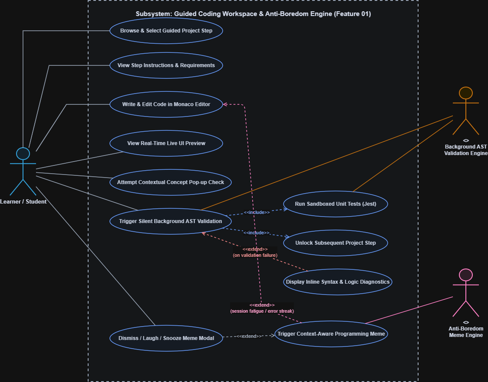
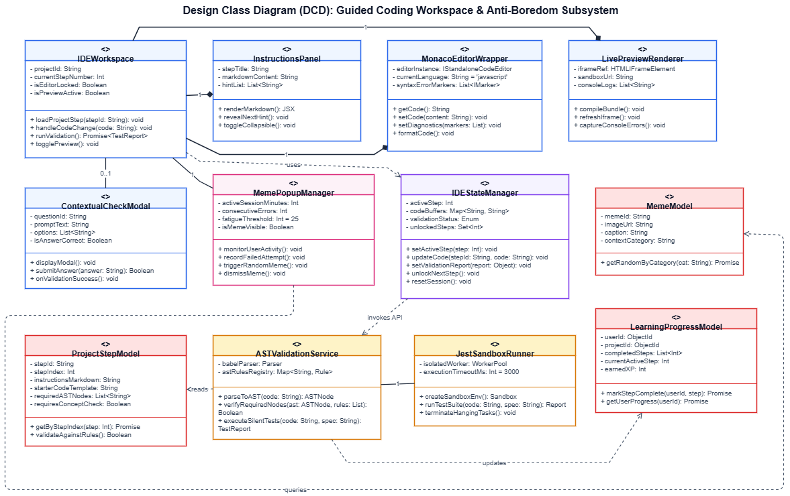
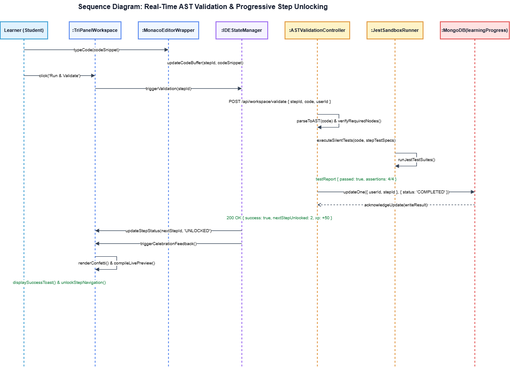
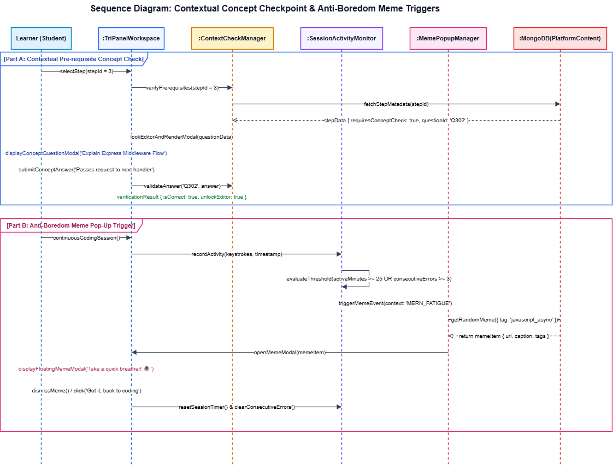
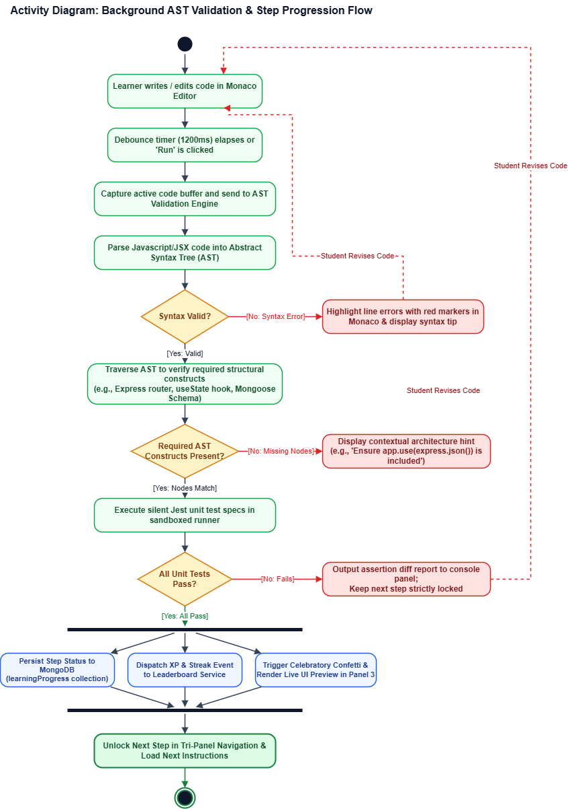
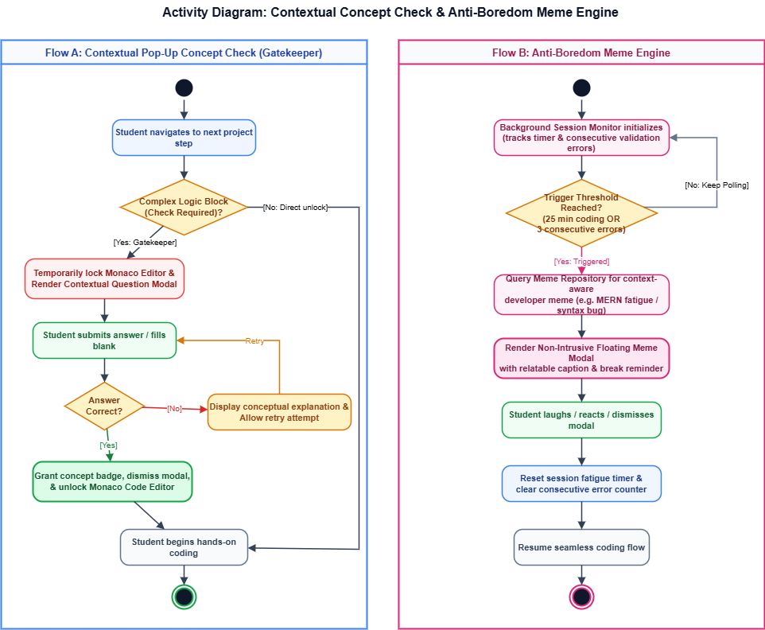
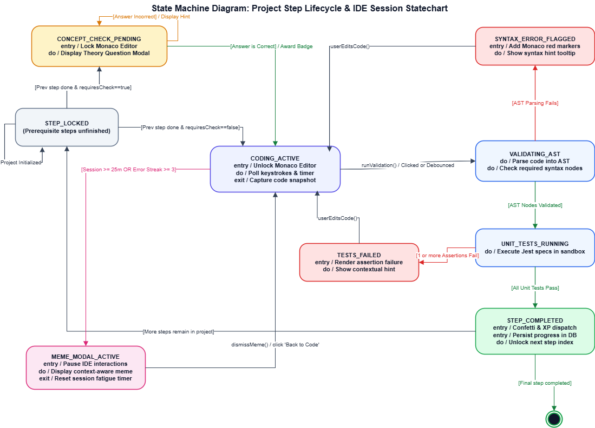
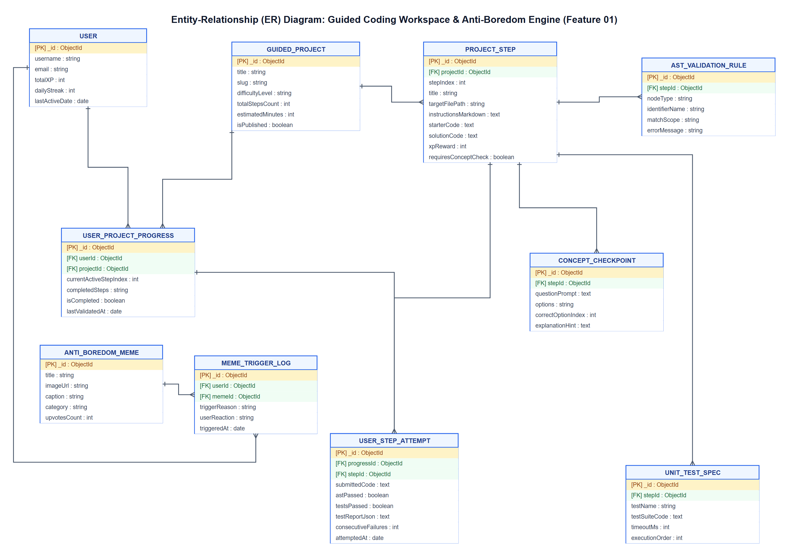

# DevCraft — Guided Coding Workspace & Contextual Interactions

### Architectural Specification & System Diagrams
**Primary Responsibility:** Feature 01 — Guided Coding Workspace, Real-Time AST Code Validation, and Contextual Interactions  
**Module Lead:** Gunasekara M.I.T. (`244068K`)  
**Project:** DevCraft — A Guided MERN Stack Learning Platform & Developer Community  
**Team:** Team 22 · DoD | Faculty of Information Technology, University of Moratuwa  
**Course:** IN2901 — Software Development Project  
**Academic Supervision:** Ms. M. N. Chandimali (Supervisor) · Mr. H. K. Gaminda Ishara (Industry Mentor, Creative Software)

---

## 1. Feature Overview

The **Guided Coding Workspace** is the central practical learning environment in DevCraft. Rather than following static video tutorials or disjointed code snippets, learners build complete, professional full-stack MERN applications step by step within a cohesive, responsive browser IDE.

### Core Capabilities
1. **Tri-Panel Interactive IDE**:
   - **Left Panel (Step Guidance)**: Progressive task instructions, markdown explanations, syntax hints, and real-time step completion checklists.
   - **Center Panel (Monaco Editor)**: Industry-standard code editor with syntax highlighting, inline diagnostic markers, auto-formatting, and intelligent tab management.
   - **Right Panel (Live Preview & Terminal)**: Dual-mode execution view displaying real-time UI previews or sandboxed backend execution outputs and assertion diffs.
2. **Two-Stage Code Validation Engine**:
   - **Stage 1 (AST Static Analysis)**: Parses learner code into an Abstract Syntax Tree (via Babel/ESLint parser) to detect required structural constructs (e.g., Express router instantiation, route handler middleware, required export syntax) without executing untrusted code.
   - **Stage 2 (Sandboxed Jest Execution)**: Executes automated behavioral unit test suites in an isolated execution sandbox to verify algorithmic correctness before unlocking subsequent steps.
3. **Contextual Concept Checks**:
   - Short, non-intrusive interactive knowledge gatekeepers that test theoretical understanding before allowing learners to advance, eliminating passive copy-pasting.
4. **Anti-Boredom & Engagement Engine**:
   - Context-aware fatigue detection monitoring session duration (e.g. >15m continuous coding) or repeated syntax errors to serve humorous, domain-relevant developer memes with snooze/dismiss actions.
5. **Project Step Roadmap & Completion Summary**:
   - Visual drawer tracking progression across all project milestones and an achievement celebration modal providing XP rewards and leaderboard progression.

---

## 2. Diagram Architecture Index

All diagram source files are maintained in native **Draw.io (`.drawio`)** format alongside high-resolution exported PNG images within the [`diagrams/`](diagrams/) directory.

| # | Diagram Name | Draw.io Source | Rendered PNG | Description |
| :-: | :--- | :--- | :--- | :--- |
| **0** | **All-in-One Multi-Page Workbook** | [All UML Workbook](diagrams/DevCraft_Feature01_Guided_Workspace_All_UML.drawio) | — | 8-tab comprehensive Draw.io workbook containing all models. |
| **1** | **Subsystem Use Case Diagram** | [use_case_workspace.drawio](diagrams/use_case_workspace.drawio) | [use_case_workspace.png](diagrams/use_case_workspace.png) | Subsystem boundary, actors, user actions, `<<include>>` and `<<extend>>` cases. |
| **2** | **Design Class Diagram (DCD)** | [class_diagram_workspace.drawio](diagrams/class_diagram_workspace.drawio) | [class_diagram_workspace.png](diagrams/class_diagram_workspace.png) | React components, Zustand store, AST services, test runner, and Mongoose models. |
| **3** | **Sequence: AST Validation & Step Unlocking** | [sequence_ast_validation.drawio](diagrams/sequence_ast_validation.drawio) | [sequence_ast_validation.png](diagrams/sequence_ast_validation.png) | Synchronous and asynchronous validation pipeline from editor keystroke to step unlock. |
| **4** | **Sequence: Concept Checks & Meme Engine** | [sequence_meme_and_check.drawio](diagrams/sequence_meme_and_check.drawio) | [sequence_meme_and_check.png](diagrams/sequence_meme_and_check.png) | Trigger conditions, verification workflows, and interaction models for fatigue interrupts. |
| **5** | **Activity: AST Code Validation & Jest Workflow** | [activity_ast_validation.drawio](diagrams/activity_ast_validation.drawio) | [activity_ast_validation.png](diagrams/activity_ast_validation.png) | End-to-end decision workflow, linting, parsing, assertion evaluation, and XP distribution. |
| **6** | **Activity: Gatekeeper Checkpoint & Meme Flow** | [activity_meme_and_check.drawio](diagrams/activity_meme_and_check.drawio) | [activity_meme_and_check.png](diagrams/activity_meme_and_check.png) | Swimlane activity showing student actions, theory quiz evaluation, and fatigue timer interrupts. |
| **7** | **State Machine Diagram: Step Lifecycle** | [state_machine_step_lifecycle.drawio](diagrams/state_machine_step_lifecycle.drawio) | [state_machine_step_lifecycle.png](diagrams/state_machine_step_lifecycle.png) | Complete finite state machine transitions for project steps (`LOCKED` to `COMPLETED`). |
| **8** | **Entity-Relationship (ER) Diagram** | [er_diagram_feature01.drawio](diagrams/er_diagram_feature01.drawio) | [er_diagram_feature01.png](diagrams/er_diagram_feature01.png) | Database schema specifying collections, primary/foreign keys, cardinality, and validation models. |

---

## 3. Subsystem Architectural Diagrams

### 3.1 Subsystem Use Case Diagram
Models learner interactions within the workspace environment, highlighting automated background services (`AST Validation Engine`, `Anti-Boredom Engine`) and extension points for error diagnostics and engagement breaks.



* **Primary Actors**: `Learner / Student`, `AST Validation Engine (Background)`, `Anti-Boredom Engine (Background)`.
* **Key Use Cases**:
  * Browse & Select Guided Project Step (`UC1`)
  * Write & Edit Code in Monaco Editor (`UC3`)
  * View Real-Time Live UI Preview (`UC4`)
  * Attempt Contextual Concept Pop-up Check (`UC5`)
  * Trigger Background AST Code Validation (`UC6`) — includes Sandboxed Unit Testing (`UC7`) and Step Unlocking (`UC8`).
  * Display Inline Syntax & Logic Diagnostics (`UC9`) — extends validation on failure.
  * Trigger Context-Aware Developer Meme (`UC10`) and Dismiss/Snooze (`UC11`).

---

### 3.2 Design Class Diagram (DCD)
Specifies the object-oriented structure of Feature 01 across the presentation layer (React + Tailwind), state management (Zustand), service tier (AST parsing, Jest runner, meme trigger), and persistence tier (Mongoose / MongoDB).



* **Presentation Layer**: `WorkspaceLayout`, `InstructionPanel`, `MonacoEditorContainer`, `LivePreviewPanel`, `ValidationFeedbackBanner`, `ConceptCheckModal`, `MemeBreakModal`, `StepRoadmapDrawer`, `ProjectCompletionModal`.
* **State Management**: `useWorkspaceStore` (Zustand) managing active step index, files buffer, AST validation results, lock statuses, and fatigue timers.
* **Service Layer**:
  * `ASTValidationService`: Tokenizes and parses code, executing AST rule visitors.
  * `TestRunnerService`: Orchestrates sandboxed Jest spec assertions.
  * `EngagementService`: Monitors session telemetry and evaluates fatigue/streak conditions.
* **Persistence Layer**: Schemas for `GuidedProject`, `ProjectStep`, `UserStepProgress`, `ASTValidationRule`, `ConceptQuestion`, and `MemeContent`.

---

### 3.3 Sequence Diagram: AST Code Validation & Progressive Step Unlocking
Traces the execution sequence when a learner edits code or initiates validation, illustrating debounce handling, AST structure inspection, sandboxed test execution, and progress persistence.



* **Interaction Steps**:
  1. Learner edits buffer in `MonacoEditor`; change triggers debounced update in `useWorkspaceStore`.
  2. Store dispatches code payload to `ASTValidationService`.
  3. Service parses AST; if syntax or required AST constructs fail, inline error markers are sent to Monaco.
  4. If AST rules pass, payload dispatches to `TestRunnerService` for isolated Jest assertion execution.
  5. Upon 100% test pass, `ProgressAPI` records completion in MongoDB, unlocks `Step N+1`, awards XP, and displays the success banner.

---

### 3.4 Sequence Diagram: Contextual Concept Checks & Meme Engine
Illustrates the interaction flow when a learner reaches a milestone gatekeeper or triggers an anti-boredom break during prolonged or challenging coding sessions.



* **Concept Check Flow**: Triggered upon clicking "Next Step"; prompts a targeted quiz question. Valid submissions unlock the editor and advance step status; invalid submissions provide review hints.
* **Meme Break Flow**: `EngagementService` detects session thresholds (`idleTime > 15m` or `errorCount >= 3`); queries `MemeService` for relevant tag-matched humor; presents dismissible modal with "Back to Coding" or "Snooze 10m" options.

---

### 3.5 Activity Diagram: AST Code Validation & Jest Runner
Visualizes the decision logic and control flow governing real-time code evaluation, diagnostic reporting, and progressive step unlocks.



* **Decision Gateways**:
  * Valid JavaScript/JSX Syntax? (No ➔ annotate editor with syntax diagnostics).
  * Required AST Constructs Present? (No ➔ display structural guidance hints).
  * Sandboxed Unit Tests Pass? (No ➔ display assertion diffs).
  * Pass ➔ Fork concurrent tasks: Update database progress, award XP, unlock next step, notify leaderboard.

---

### 3.6 Activity Diagram: Concept Gatekeeper & Anti-Boredom Workflow
Details the swimlane process between the Learner, Workspace UI, and Background Engagement Services.



* **Key Paths**:
  * Step Advancement Gate: Evaluates prerequisite comprehension checks.
  * Fatigue Intercept: Detects prolonged cognitive load and delivers context-aware humor without interrupting unsaved editor progress.

---

### 3.7 State Machine Diagram: Project Step Progress Lifecycle
Formalizes the finite state machine transitions for individual project steps from initial lock to verified mastery.



* **States**:
  * `STEP_LOCKED`: Prerequisite steps not yet satisfied.
  * `CONCEPT_GATEKEEPER`: Unlocked but awaiting concept quiz validation.
  * `STEP_ACTIVE_EDITING`: Monaco editor unlocked; active code authoring.
  * `VALIDATING_AST`: Background structural analysis in progress.
  * `VALIDATION_FAILED`: Errors detected; inline diagnostic markers active.
  * `TESTING_SANDBOX`: Automated test suite executing.
  * `STEP_COMPLETED`: Tests passed; step finalized and XP committed.
  * `PROJECT_MASTERED`: All steps cleared; certificate and badge awarded.

---

### 3.8 Entity-Relationship (ER) Diagram: Guided Workspace Data Architecture
Defines the relational and document models backing Feature 01 in MongoDB, documenting field data types, primary/foreign keys, embedded documents, and referential integrity.



* **Entities**:
  * `GUIDED_PROJECT`: Tracks title, track category (MERN), difficulty, total steps, and reward XP.
  * `PROJECT_STEP`: Ordered steps containing markdown instructions, starter files, solution code, and time estimates.
  * `USER_STEP_PROGRESS`: Records individual user attempts, code snapshots, pass status, test outputs, and completion timestamps.
  * `AST_VALIDATION_RULE`: Structural rules evaluated by Babel visitors (node type, parent type, identifier names).
  * `CONCEPT_QUESTION`: Gatekeeper quiz questions with multiple-choice options, correct answers, and review references.
  * `MEME_CONTENT`: Curated developer humor assets tagged by language/concept with fatigue triggers.

---

## 4. Technical Stack & Implementation Boundary

| Component | Technology | Rationale |
| :--- | :--- | :--- |
| **Code Editor** | Monaco Editor (`@monaco-editor/react`) | Full VS Code engine in browser, syntax highlighting, diff viewing, marker API. |
| **AST Analysis** | `@babel/parser` & `@babel/traverse` | Lightweight, robust AST generation and node inspection in client or Node runtime. |
| **Test Sandbox** | Node.js `vm` / Isolated Runner | Safe, isolated execution of learner scripts against pre-written Jest assertions. |
| **State Management** | Zustand | Minimal, fast reactive store for editor buffers, step states, and UI drawers. |
| **Styles & Theme** | Tailwind CSS (Dark Slate & Mint Cyan) | Aligned with DevCraft design system (`#0B1220`, `#131F30`, `#69E5BE`, `#F6AB50`). |
| **Persistence** | MongoDB & Mongoose | Flexible document schema for versioned project steps, code buffers, and progress records. |

---

## 5. Directory Contents

```text
docs/
├── README.md                                             # Feature 01 Architectural Specification & Index (This File)
└── diagrams/
    ├── DevCraft_Feature01_Guided_Workspace_All_UML.drawio # Complete multi-page Draw.io workbook
    ├── use_case_workspace.drawio                         # Use case diagram source
    ├── use_case_workspace.png                            # Rendered use case diagram
    ├── class_diagram_workspace.drawio                    # Design class diagram source
    ├── class_diagram_workspace.png                       # Rendered design class diagram
    ├── sequence_ast_validation.drawio                    # AST validation sequence source
    ├── sequence_ast_validation.png                       # Rendered AST validation sequence
    ├── sequence_meme_and_check.drawio                    # Concept/Meme sequence source
    ├── sequence_meme_and_check.png                       # Rendered Concept/Meme sequence
    ├── activity_ast_validation.drawio                    # AST validation activity source
    ├── activity_ast_validation.png                       # Rendered AST validation activity
    ├── activity_meme_and_check.drawio                    # Concept/Meme activity source
    ├── activity_meme_and_check.png                       # Rendered Concept/Meme activity
    ├── state_machine_step_lifecycle.drawio               # State machine diagram source
    ├── state_machine_step_lifecycle.png                  # Rendered state machine diagram
    ├── er_diagram_feature01.drawio                       # Entity-relationship diagram source
    └── er_diagram_feature01.png                          # Rendered entity-relationship diagram
```

---
*DevCraft · Team 22 — DoD · IN2901 Software Development Project · University of Moratuwa*
